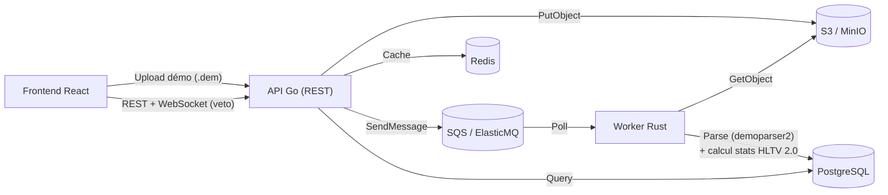

# CS_Analyser

Plateforme distribuée d'analyse de démos Counter-Strike 2. Ce projet exploite une architecture microservices pour ingérer, traiter et restituer des données tactiques complexes issues de fichiers `.dem`.

## Architecture technique

* **Frontend :** React 18, React Router, Tailwind CSS
* **Backend API :** Go (`net/http`), REST, WebSockets (veto de cartes en temps réel)
* **Data Processing :** Rust (tokio), `demoparser2`
* **Infrastructure :** Docker Compose (environnement local), AWS S3 / SQS (stockage et file de messages, simulés localement via MinIO et ElasticMQ)
* **Bases de données :** PostgreSQL (métadonnées, statistiques, télémétrie spatiale)
* **Cache :** Redis

> Le backend expose une API **REST** (pas de GraphQL) et toutes les données persistantes transitent par **PostgreSQL** (pas de ClickHouse à ce jour). Ces deux technologies font partie de la [Roadmap](#roadmap) mais ne sont pas encore implémentées.

## Pipeline de données

## Fonctionnalités principales

* **Ingestion asynchrone :** upload de démos via l'API, traitement en file de messages SQS par un worker Rust scalable.
* **Moteur statistique :** calcul du rating HLTV 2.0 (KPR, DPR, KAST, Impact, ADR) côté Rust à partir des événements extraits de la démo.
* **Profilage spatial :** analyse de la télémétrie 3D (X, Y, Z) des positions de setup défensif pour déterminer les zones occupées par chaque joueur.
* **Veto en direct :** système de sélection/bannissement de cartes en temps réel via WebSocket, pour les formats BO1 et BO3.
* **Intégrations externes :** connexion Steam (OpenID) et agrégation des statistiques FACEIT par carte.
* **Administration :** gestion des utilisateurs, des cartes compétitives et supervision de la file de traitement.

## Roadmap

Fonctionnalités et choix techniques envisagés pour la suite :

* **Analyse comportementale** : détection d'habitudes de jeu (bonnes/mauvaises) via des règles métier, puis synthèse en langage naturel via IA.
* **Scouting d'équipe adverse** : agrégation de démos tierces (ex. ESEA) pour estimer maps préférées, instabans et probabilités de pick.
* **Vue coach / macro équipe** : tableau de bord agrégé au niveau d'un roster complet.
* **Veto par lien partageable** : création d'un challenge de veto public sans compte requis pour l'équipe adverse.
* **GraphQL** : couche de requêtage pour les vues imbriquées (scouting, coach) une fois leur modèle de données stabilisé.
* **ClickHouse** : stockage des séries temporelles si le volume de télémétrie spatiale le justifie.
* **Infrastructure as Code** : provisionnement Terraform/CDK d'un environnement AWS réel (S3, SQS, RDS, IAM) en remplacement du docker-compose local.

Le détail du découpage en tickets est suivi dans les [Issues](https://github.com/abwii/CS_Analyser/issues) du dépôt.

## Structure du monorepo

* `/apps/web` : Application client (React)
* `/apps/api` : Serveur d'interface et de gestion de sessions (Go)
* `/apps/parser` : Service de déconstruction des binaires de jeu (Rust)

## Prérequis

* Docker et Docker Compose
* Go 1.25+
* Rust (cargo)
* Node.js 20+

## Installation locale

1. Cloner le dépôt.
2. Copier les fichiers d'environnement : `cp apps/api/.env.example apps/api/.env`, `cp apps/parser/.env.example apps/parser/.env`, `cp apps/web/.env.example apps/web/.env`
3. Démarrer les services d'infrastructure (PostgreSQL, SQS local, Redis, MinIO) via Docker : `docker-compose up -d`
4. Lancer l'API Go : `cd apps/api && go run main.go`
5. Lancer le worker Rust : `cd apps/parser && cargo run`
6. Lancer le frontend : `cd apps/web && npm install && npm run dev`

## Licence

Distribué sous licence [MIT](LICENSE).

## Auteurs

Wassim Bacha
